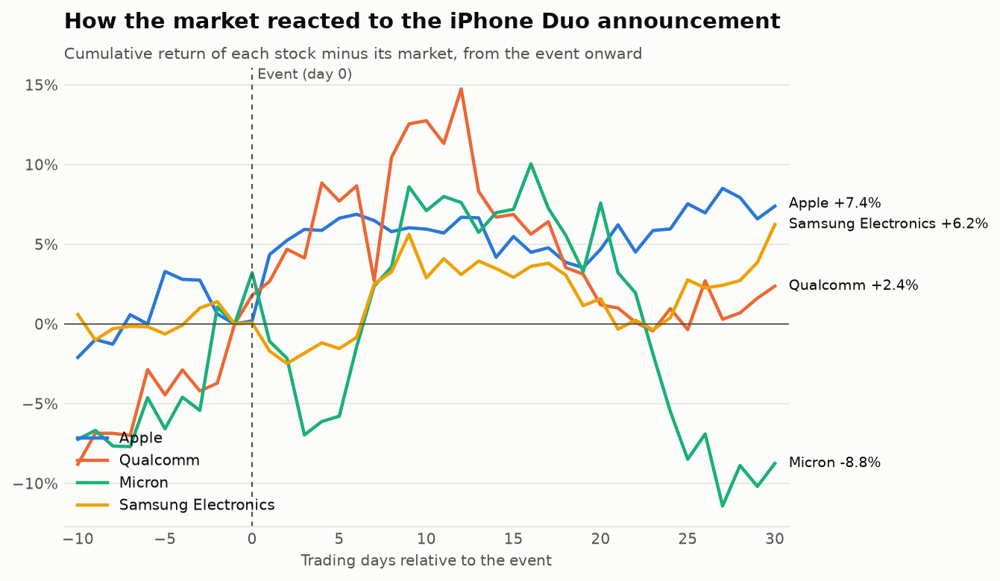
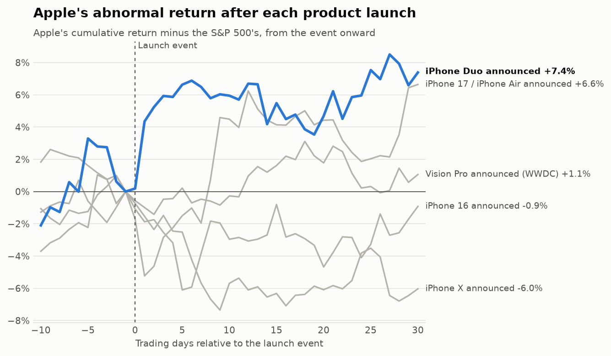
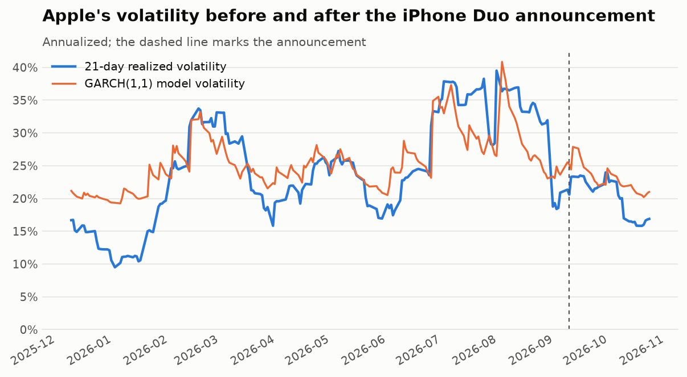
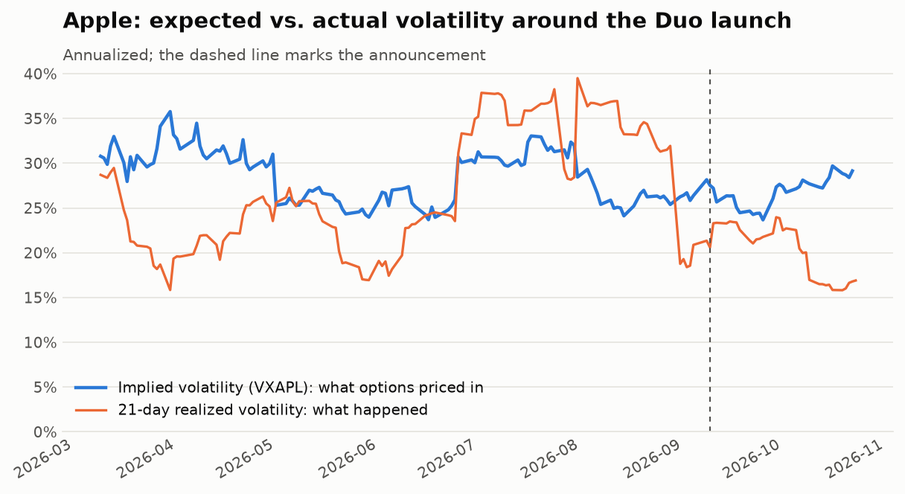
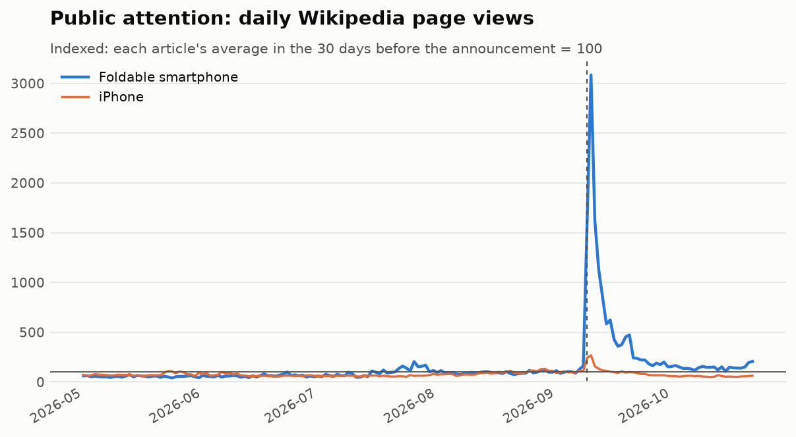

# How did the market react to Apple's iPhone Duo?

An event study of Apple's first foldable iPhone. On **September 9, 2026**, Apple announced the
iPhone Duo; it went on sale on **October 23, 2026**. This project measures how much Apple, two of
its suppliers, and its main foldable competitor moved **beyond what the overall market
predicted**, compares the reaction with Apple's past launches, and checks whether volatility
changed afterward.

**Live dashboard:** *(add your Streamlit link here)*



## The question

A launch is news. If investors thought the Duo changed Apple's prospects, it should show up in
the stock price. But stocks also move every day for reasons that have nothing to do with Apple.
An event study separates the two by asking: *how much did each stock move beyond what the market
alone would have predicted?*

| Company | Why it's included |
|---|---|
| **Apple** (AAPL) | The company launching the Duo |
| **Qualcomm** (QCOM) | The Duo uses Apple's own C2 modem instead of Qualcomm's chips |
| **Micron** (MU) | Memory supplier; its CEO appeared at the launch, which is unusual for Apple |
| **Samsung Electronics** (005930.KS) | The leading foldable phone maker and the Duo's main rival |

## Results

<!-- RESULTS:START -->
*Auto-generated by `run_analysis.py` with prices through **2026-10-23**.*

#### Cumulative abnormal return after the Duo announcement

| Company | Method | Event day | Days -1 to +1 | Days -5 to +5 | Days 0 to +30 |
|---|---|---|---|---|---|
| Apple | Market model | -0.09% | +2.84% | +4.49% | +2.85% |
|  | Market-adjusted | +0.19% | +3.72% | +6.64% | +7.39% |
|  | Multi-factor | +0.79% | +4.42%* | +6.34% | +2.02% |
| Qualcomm | Market model | +2.31% | +8.20% | +12.06% | -0.73% |
|  | Market-adjusted | +1.79% | +6.38% | +10.57% | +2.37% |
|  | Multi-factor | +1.44% | +6.78% | +11.24% | +4.18% |
| Micron | Market model | +3.74% | -0.06% | -3.48% | -29.36% |
|  | Market-adjusted | +3.22% | -2.14% | -1.16% | -8.75% |
|  | Multi-factor | +0.03% | -7.27% | -11.77% | -17.70% |
| Samsung Electronics | Market model | -0.01% | -3.35% | -3.54% | +4.58% (27d so far) |
|  | Market-adjusted | +0.07% | -3.10% | -1.37% | +2.26% (27d so far) |

Stars mark statistical significance: \*\*\* p<0.01, \*\* p<0.05, \* p<0.10.

**Three definitions of "normal."** The *market model* predicts each stock from its market using a fitted alpha and beta. The *market-adjusted* version is simply the stock's return minus its market's. The *multi-factor* model also controls for size, value and momentum (US stocks only). Over a few days they agree closely. Over 30 days they can differ, because the market and multi-factor models include an alpha that assumes a stock's pre-event trend continues: a stock on a hot streak (like Micron) then shows a large "abnormal" loss just for cooling off. For long windows, the market-adjusted figure is the safer read, and conclusions here rely only on results where the methods agree.

#### Apple: the Duo vs. past launches

| Launch | Date | Days -1 to +1 | t-stat | Days 0 to +30 (market-adjusted) |
|---|---|---|---|---|
| iPhone Duo announced | 2026-09-09 | +2.84% | 1.04 | +7.39% |
| iPhone 17 / iPhone Air announced | 2025-09-09 | -6.08%*** | -2.68 | +6.64% |
| iPhone 16 announced | 2024-09-09 | -1.02% | -0.42 | -0.92% |
| Vision Pro announced (WWDC) | 2023-06-05 | -2.63% | -1.40 | +1.06% |
| iPhone X announced | 2017-09-12 | -1.39% | -1.04 | -6.04% |

#### Volatility, 30 trading days before vs. after (annualized)

| Company | Before | After | Change | Levene p-value |
|---|---|---|---|---|
| Apple | 29.5% | 18.1% | -11.4% | 0.140 |
| Qualcomm | 42.7% | 49.4% | +6.7% | 0.716 |
| Micron | 85.3% | 50.7% | -34.7% | 0.194 |
| Samsung Electronics | 104.5% | 57.7% | -46.8% | 0.254 |

Apple GARCH(1,1): alpha = 0.073, beta = 0.862, persistence = 0.934 (a volatility shock loses half its effect in about 10 trading days).

#### Public attention (daily Wikipedia page views)

| Article | Avg. daily views, 30 days before | 30 days after | Change | Busiest day |
|---|---|---|---|---|
| Foldable smartphone | 208 | 1,023 | 4.9× | 2026-09-10 (6,427) |
| iPhone | 4,978 | 4,728 | 0.9× | 2026-09-10 (13,362) |

<!-- RESULTS:END -->

### The Duo vs. Apple's past launches



### Volatility



### What options traders expected

Options prices reveal how big a move traders were bracing for. Apple's implied volatility index
(VXAPL) shows what was priced in before the announcement, compared with what actually happened.



### Public attention

Daily Wikipedia page views show whether ordinary people noticed, not just investors.



## Method

1. **Learn "normal."** For each stock, fit a market model over 120 trading days well before the
   event (days −150 to −31): `stock return = α + β × market return`. US stocks are compared with
   the S&P 500 (SPY); Samsung with the Korean market (KOSPI).
2. **Abnormal returns.** Around the event, abnormal return = actual return − (α + β × market return).
   Two robustness checks run alongside it:
   - **Market-adjusted:** stock return − market return. Cruder, but it can't extrapolate a pre-event
     hot streak the way α can, so it is the safer read over long windows.
   - **Multi-factor (Fama-French style):** adds size, value and momentum factors. The official
     Fama-French data is published with a lag, so the factors are built daily from ETFs:
     size = IWM − SPY, value = IWD − IWF, momentum = MTUM − SPY.
3. **Cumulative abnormal return (CAR).** Sum abnormal returns over windows such as days −1 to +1
   and 0 to +30, and test significance with a t-statistic based on the stock's normal daily noise.
4. **Volatility.** Compare annualized volatility 30 trading days before vs. after (Levene's test),
   and fit a GARCH(1,1) model by maximum likelihood to see how persistent volatility shocks are.
5. **Expectations.** From Cboe's Apple implied volatility index (VXAPL), compute the one-day move
   options traders were pricing in, and compare it with the actual move and the next month's
   realized volatility.
6. **Attention.** Daily Wikipedia page views (Wikimedia's official API) for "Foldable smartphone"
   and "iPhone", indexed to their pre-event average. Wikipedia replaces Google Trends here because
   Trends has no official API and often blocks automated requests.

The math is checked against simulated data with known answers in `tests/`.

## Limitations

- **Overlapping news.** John Ternus became CEO on September 1, 2026, and the iPhone 18 Pro was
  announced at the same event. The event study captures the reaction to everything the market
  learned that day, not the Duo alone.
- **Expectations.** A foldable iPhone was rumored for years, so much of the news may have been
  priced in before the announcement. Small abnormal returns can mean "expected," not "unimportant."
- **Sales data is new.** The Duo went on sale October 23, 2026, so the post-launch window is still
  filling in. A GitHub Action re-runs the analysis every weekday, so the numbers update over time.
- **Time zones.** Apple's event ended overnight in Seoul, so Samsung's day 0 is the next Korean
  trading day.

## Run it yourself

```bash
git clone https://github.com/Gaurang7/Iphone-duo-event-study.git
cd iphone-duo-event-study
pip install -r requirements.txt

python run_analysis.py --refresh   # download prices, run everything, update this README
streamlit run app.py               # open the interactive dashboard
python -m pytest tests             # check the math on simulated data
```

## Project structure

```
config.py              every setting: stocks, events, windows
run_analysis.py        runs the whole project and writes results/ and figures/
app.py                 interactive Streamlit dashboard
src/data.py            downloads and caches prices
src/event_study.py     market, market-adjusted and multi-factor models; CAR; t-tests
src/volatility.py      realized volatility, before/after test, GARCH(1,1)
src/expectations.py    options-implied volatility vs. what happened
src/attention.py       Wikipedia page views (public attention)
src/charts.py          the static charts in this README
tests/                 checks the math against simulated data
.github/workflows/     refreshes the data and results every weekday
```

## Next steps

- **Intraday data:** Apple's event started at 1pm Eastern; minute-by-minute prices would show how
  quickly the market reacted during the presentation itself.
- **Sales signals:** once Duo sales or shipment estimates are reported, test whether the stock
  reaction predicted actual demand.
- **Peer portfolio:** extend to all major Apple suppliers to see which ones the market treated as
  winners or losers.

---

Built by **Gaurang Agarwal** · MS in Quantitative Management, Duke University (Fuqua)
